# Pulso — Gestão de Ginásio

Aplicação web para um ginásio pequeno deixar o papel e o Excel: **sócios, planos, mensalidades, aulas e presenças** num só sítio, com **controlo de acessos por perfil (RBAC)**: cada pessoa só vê e faz o que o seu perfil permite.


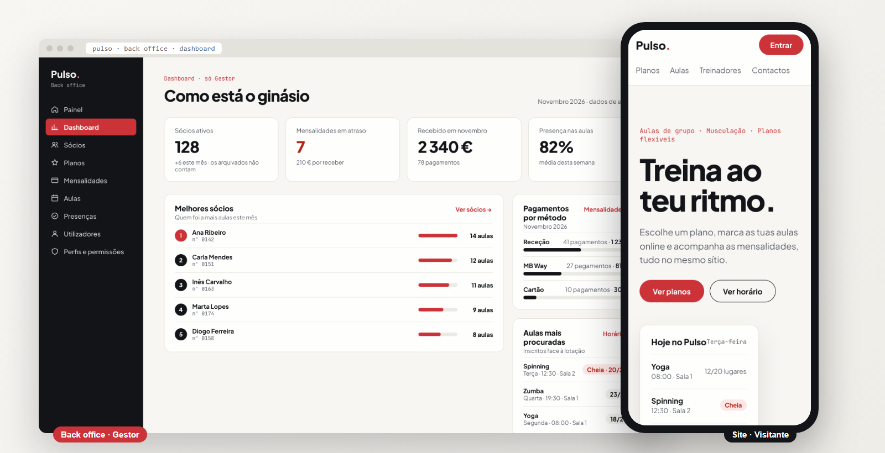

> Projeto da unidade curricular **Programação para a Web**, CTESP em Tecnologias e Programação de Sistemas de Informação (TPSI), 2026/2027. Os nomes, valores e datas são dados de exemplo.

<details>
<summary><b>English summary</b></summary>

Pulso is a gym management web app built as a course project. It has a **public site** (plans, class schedule, sign-up), a **member area** (book classes, see and pay monthly fees by MB Way or card) and a **back office** for staff (members, payments, classes, attendance, team and a manager dashboard).

Access is controlled with **role-based access control (RBAC)** stored in the database: **5 roles** (Manager, Receptionist, Trainer, Member and Visitor, who is anyone not logged in) and **28 permissions, one per action** (view, create, edit, archive). Every page and every action is checked on the server (403 otherwise), and trainers only see and edit *their own* classes (the filter is in the SQL query).

Stack: PHP 8.3, MySQL 8.4, Docker Compose, HTML/CSS. Screens were designed first as a clickable Figma prototype. The RBAC is covered by an automated HTTP test script (40 checks across all roles).
</details>

---

## Em 30 segundos

- **3 partes:** site público (Visitante), área do sócio e back office da equipa.
- **5 perfis e 28 permissões**, uma por ação: ver, criar, editar e arquivar, guardadas na base de dados.
- **Segurança no servidor:** cada página e cada botão verificam a permissão. Sem ela, a resposta é **403**, mesmo que alguém escreva o endereço à mão.
- **"Só as suas":** o treinador só vê e edita as aulas que dá. O filtro está na própria consulta SQL.
- **Nada se apaga:** sócios, planos e aulas são **arquivados**, para o histórico ficar guardado.
- **Pagamentos** na receção, por **MB Way** ou com **cartão** (simulado), com registo do método e de quem registou.
- **Desenhado antes de programado:** protótipo clicável em Figma, para computador e telemóvel.
- **Testado:** 40 testes automáticos ao RBAC, perfil a perfil ([`tests/rbac.sh`](tests/rbac.sh)).

## Ecrãs

| Site público (Visitante) | Área do sócio |
|---|---|
| 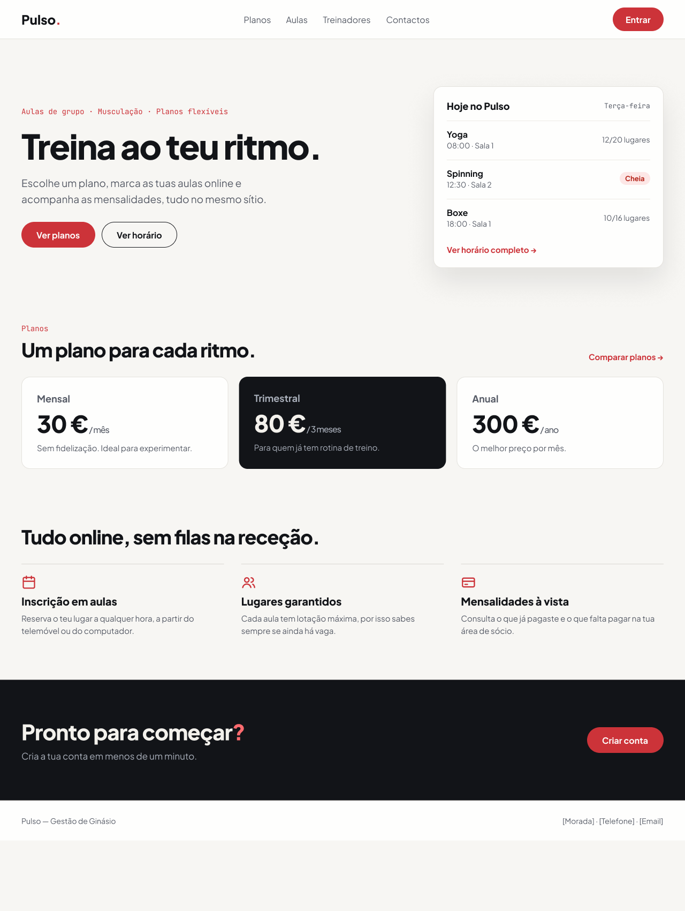 | 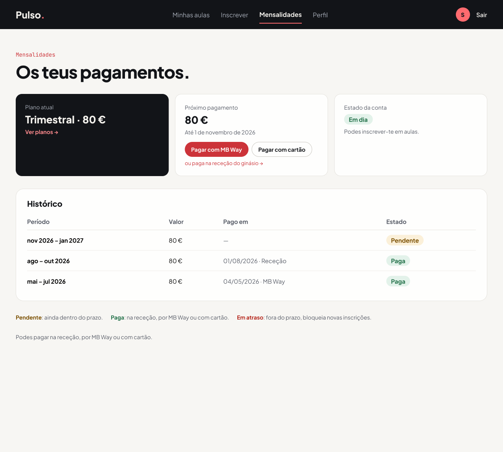 |
| **Horário das aulas**: o visitante vê que aulas existem; os lugares livres só aparecem ao sócio | **Registo** de sócio com escolha de plano |
| 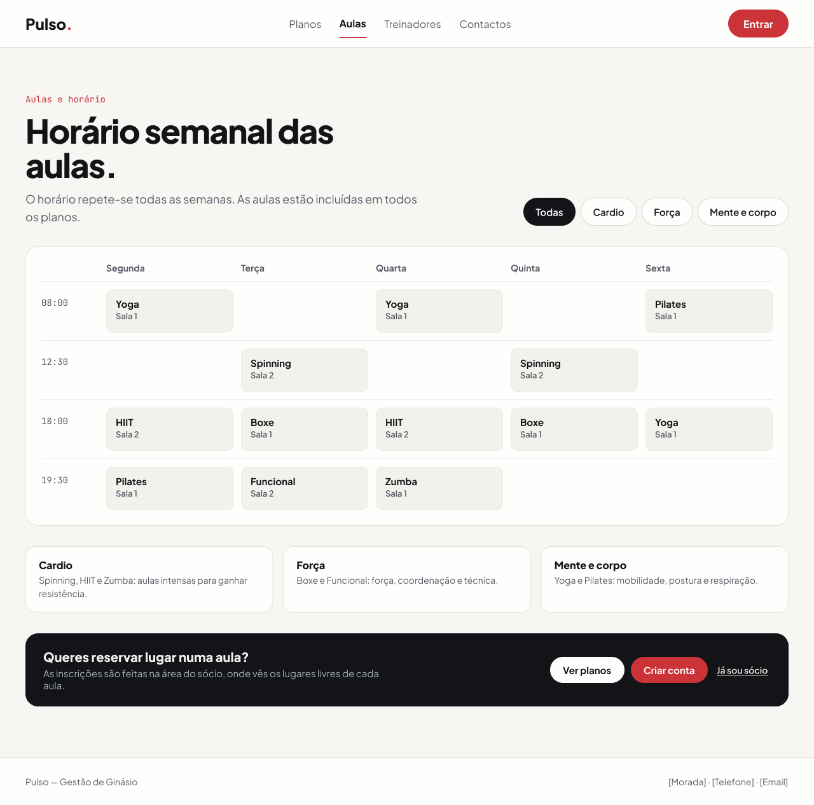 | 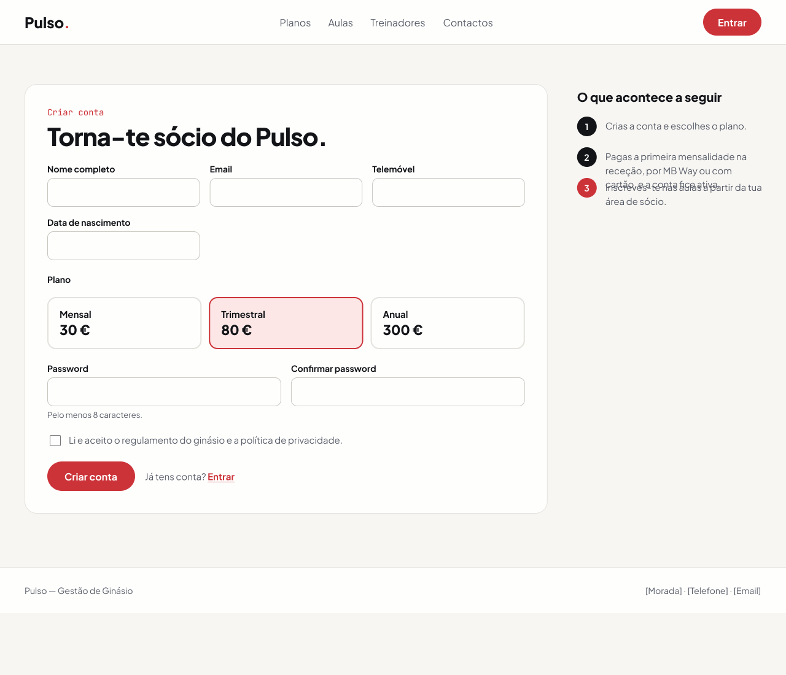 |

| Back office | |
|---|---|
| **Painel** (muda conforme o perfil) | **Dashboard** do gestor: melhores sócios, pagamentos por método |
| 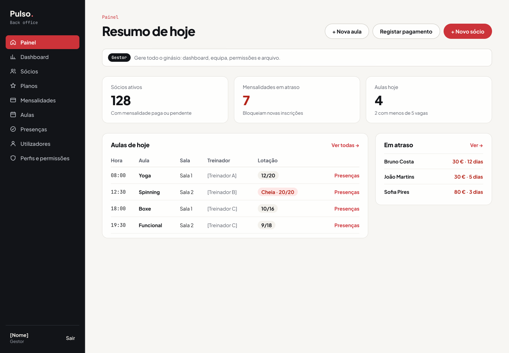 | 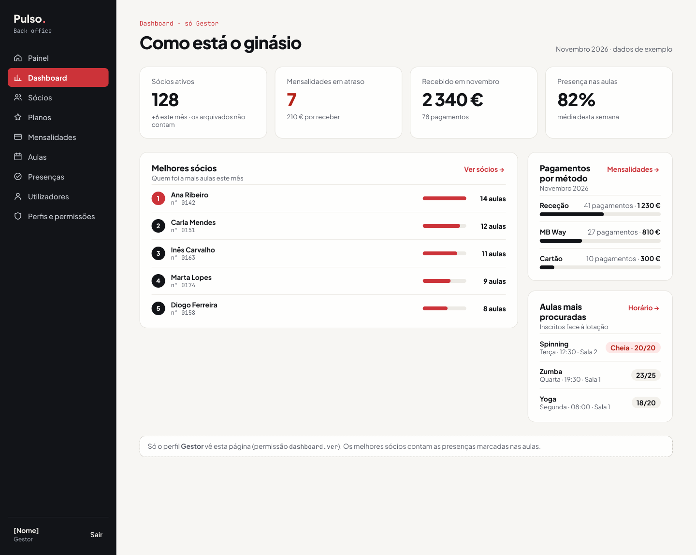 |
| **Sócios**, com o separador "Arquivados" | **Perfis e permissões**: a matriz do RBAC, editável |
| 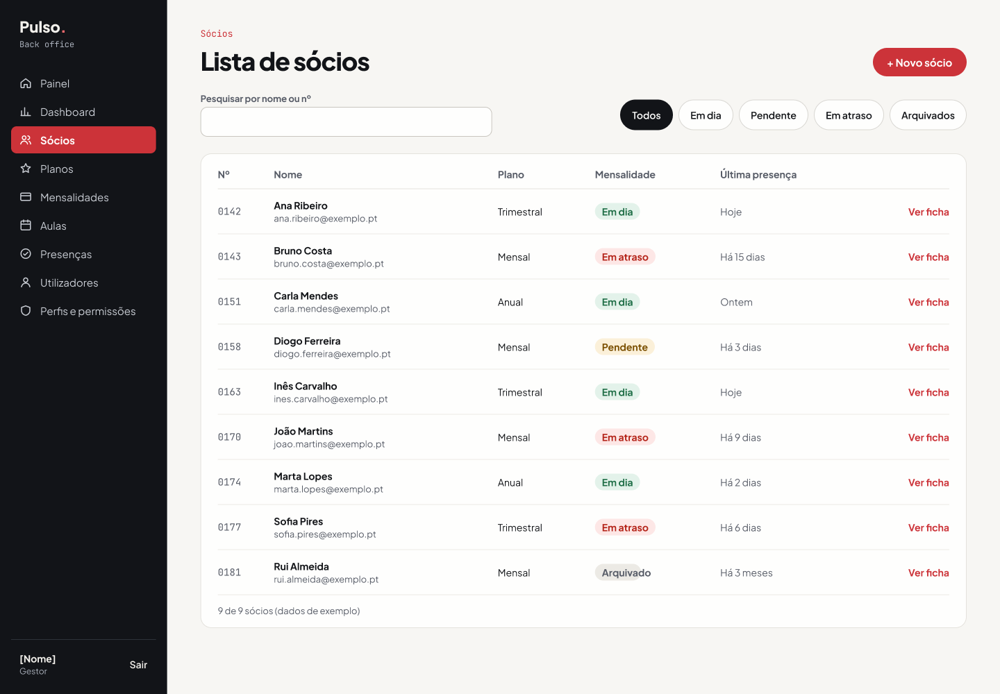 | 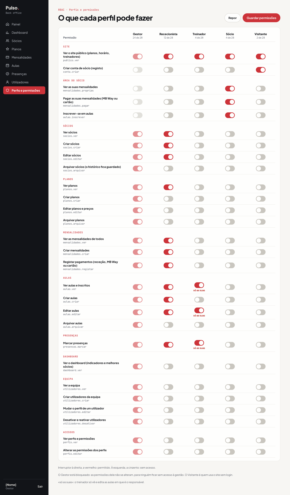 |

Todos os ecrãs têm versão para **telemóvel**:

<p>
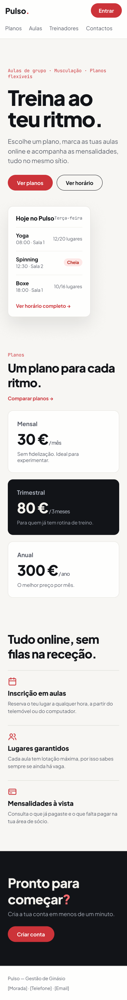
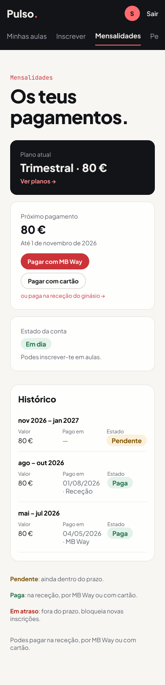
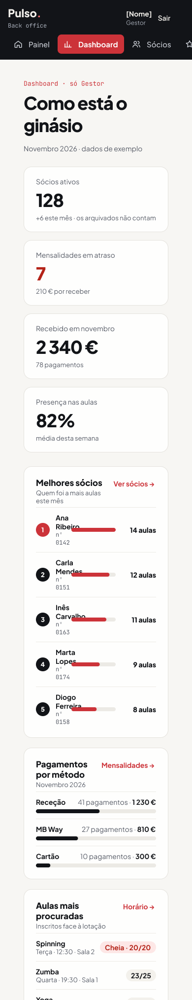
</p>

**Protótipo clicável no Figma:** [front office](https://www.figma.com/proto/Fp9SiqKnbgXfbWsy3TJppp?node-id=1-2&starting-point-node-id=1%3A2) · [back office](https://www.figma.com/proto/Fp9SiqKnbgXfbWsy3TJppp?node-id=12-2&starting-point-node-id=12%3A2). A descrição de cada ecrã está em [docs/04-ecras.md](docs/04-ecras.md).

## Como funciona o controlo de acessos (RBAC)

Cada utilizador tem **um perfil**, e cada perfil tem **várias permissões**. O código nunca pergunta "és gestor?"; pergunta "tens a permissão `socios.arquivar`?". Assim, mudar o que um perfil pode fazer é ligar ou desligar uma permissão no ecrã *Perfis e permissões*, sem tocar no código.

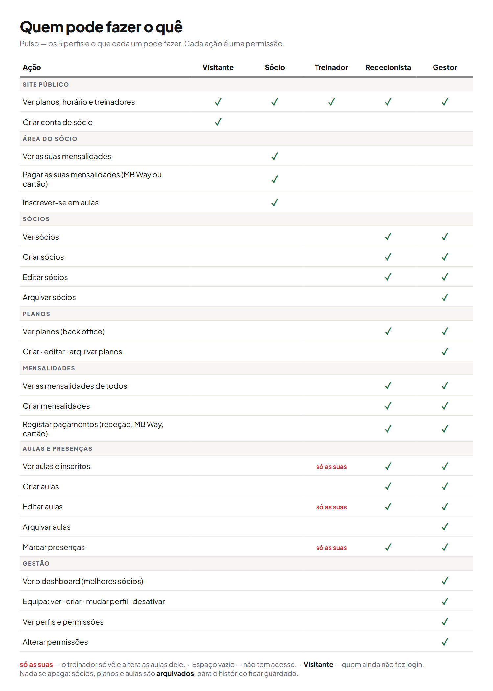

| Perfil | Quem é | O que faz |
|---|---|---|
| **Visitante** | Quem não fez login | Vê o site público e cria conta |
| **Sócio** | Cliente do ginásio | Inscreve-se em aulas, vê e paga as suas mensalidades |
| **Treinador** | Dá as aulas | Vê, edita e marca presenças **só nas suas** aulas |
| **Rececionista** | Balcão da receção | Sócios (ver, criar, editar), mensalidades, pagamentos, aulas, presenças |
| **Gestor** | Dono do ginásio | Tudo no back office: arquivar, planos, equipa, permissões, dashboard |

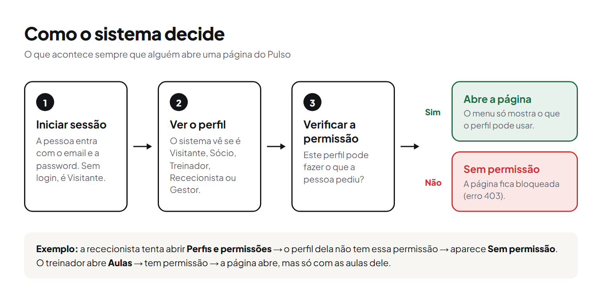

<details>
<summary><b>Matriz completa: 28 permissões × 5 perfis</b></summary>

| Permissão | Gestor | Rececionista | Treinador | Sócio | Visitante |
|---|:-:|:-:|:-:|:-:|:-:|
| `publico.ver` | ✅ | ✅ | ✅ | ✅ | ✅ |
| `conta.criar` |  |  |  |  | ✅ |
| `mensalidades.proprias` |  |  |  | ✅ |  |
| `mensalidades.pagar` |  |  |  | ✅ |  |
| `aulas.inscrever` |  |  |  | ✅ |  |
| `socios.ver` | ✅ | ✅ |  |  |  |
| `socios.criar` | ✅ | ✅ |  |  |  |
| `socios.editar` | ✅ | ✅ |  |  |  |
| `socios.arquivar` | ✅ |  |  |  |  |
| `planos.ver` | ✅ | ✅ |  |  |  |
| `planos.criar` | ✅ |  |  |  |  |
| `planos.editar` | ✅ |  |  |  |  |
| `planos.arquivar` | ✅ |  |  |  |  |
| `mensalidades.ver` | ✅ | ✅ |  |  |  |
| `mensalidades.criar` | ✅ | ✅ |  |  |  |
| `mensalidades.registar` | ✅ | ✅ |  |  |  |
| `aulas.ver` | ✅ | ✅ | ✅ ¹ |  |  |
| `aulas.criar` | ✅ | ✅ |  |  |  |
| `aulas.editar` | ✅ | ✅ | ✅ ¹ |  |  |
| `aulas.arquivar` | ✅ |  |  |  |  |
| `presencas.marcar` | ✅ | ✅ | ✅ ¹ |  |  |
| `dashboard.ver` | ✅ |  |  |  |  |
| `utilizadores.ver` | ✅ |  |  |  |  |
| `utilizadores.criar` | ✅ |  |  |  |  |
| `utilizadores.editar` | ✅ |  |  |  |  |
| `utilizadores.desativar` | ✅ |  |  |  |  |
| `perfis.ver` | ✅ |  |  |  |  |
| `perfis.editar` | ✅ |  |  |  |  |
| **Total** | **24** | **12** | **4** | **4** | **2** |

¹ Só nas aulas em que é o treinador. A matriz também está num PDF de uma página: [docs/Matriz de permissoes - RBAC v2.pdf](<docs/Matriz de permissoes - RBAC v2.pdf>).
</details>

**Como está feito** (em [`app/inc/bootstrap.php`](app/inc/bootstrap.php)):

- As permissões são **lidas da base de dados em cada pedido**, por isso uma alteração na matriz aplica-se logo.
- Quem não fez login recebe as permissões do perfil **Visitante**, que também estão na base de dados.
- Cada página começa com `exigir('codigo')`, e cada ação volta a verificar antes de gravar (por exemplo, `exigir('socios.arquivar')`).
- O menu só mostra o que o perfil pode usar, mas **a proteção verdadeira está no servidor**.
- O **Gestor** está bloqueado: as permissões dele não se alteram, para ninguém ficar sem acesso à gestão.

## Destaques técnicos

| | |
|---|---|
| **Passwords** | `password_hash()` / `password_verify()`; `session_regenerate_id()` no login |
| **SQL** | Sempre com consultas preparadas (PDO), sem concatenar dados do utilizador |
| **Formulários** | Token **CSRF** em todos os formulários; um token vazio é sempre recusado |
| **Saída** | `htmlspecialchars` em tudo o que vem da base de dados |
| **Âmbito** | "Só as suas" aplicado na consulta (`WHERE treinador_id = ?`) e verificado ao gravar |
| **Propriedade** | O sócio só consegue pagar as **suas** mensalidades (o servidor confirma) |
| **Histórico** | Arquivar em vez de apagar (`arquivado_em`); contas da equipa desativadas, não apagadas |
| **Ambiente** | Docker Compose com PHP + Apache, MySQL e phpMyAdmin; a base de dados é criada sozinha |
| **Testes** | [`tests/rbac.sh`](tests/rbac.sh): 40 pedidos HTTP reais, perfil a perfil, incluindo tentativas de acesso proibido |

## Modelo de dados

10 tabelas em três áreas: **acessos** (`perfis`, `permissoes`, `perfil_permissao`, `utilizadores`), **sócios e pagamentos** (`planos`, `socios`, `mensalidades`) e **aulas** (`modalidades`, `aulas`, `inscricoes`).

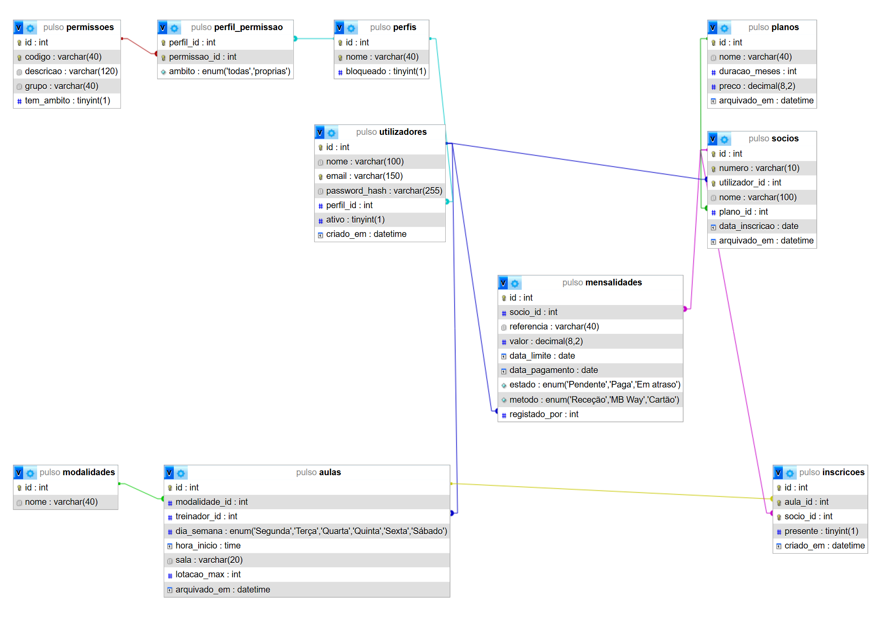

Esquema em [`db/init/01-schema.sql`](db/init/01-schema.sql), dados de exemplo em [`db/init/02-seed.sql`](db/init/02-seed.sql) e regras de negócio em [docs/03-modelo-de-dados.md](docs/03-modelo-de-dados.md).

**Regras de negócio**
- Uma aula cheia (`lotacao_max`) não aceita mais inscrições.
- Uma mensalidade **em atraso** bloqueia novas inscrições.
- O sócio cancela uma inscrição até **2 horas** antes da aula.
- Estados da mensalidade: *Pendente*, *Paga* e *Em atraso*. O pagamento é feito na receção, por MB Way ou com cartão.

## Experimentar

Requisito: [Docker Desktop](https://www.docker.com/products/docker-desktop/).

```bash
git clone https://github.com/joanacardosox/pulso-gestao-ginasio.git
cd pulso-gestao-ginasio
docker compose up -d --build
```

| Serviço | Endereço |
|---|---|
| Aplicação | http://localhost:8090 (sem login, entras como **Visitante**) |
| phpMyAdmin | http://localhost:8091 (utilizador `pulso`, password `pulso`) |

**Contas de demonstração** (só existem na base de dados local de testes):

| Perfil | Email | Password |
|---|---|---|
| Gestor | gestor@pulso.test | Gestor123! |
| Rececionista | rececao@pulso.test | Rececao123! |
| Treinador | treinador@pulso.test | Treinador123! |
| Sócio | socio@pulso.test | Socio123! |

Experimenta entrar como rececionista e abrir `http://localhost:8090/backoffice/perfis.php`: aparece **403 — Sem permissão**.

**Correr os testes** (com a aplicação ligada):

```bash
bash tests/rbac.sh
```

> Se já tinhas corrido uma versão anterior, apaga a base de dados antiga para ser criada de novo: `docker compose down -v` e depois `docker compose up -d --build`.

## Estrutura do projeto

```
pulso/
├── app/                  Aplicação PHP
│   ├── index.php         Site público (Visitante)
│   ├── registo.php       Criar conta de sócio
│   ├── login.php
│   ├── area/             Área do sócio (aulas, mensalidades)
│   ├── backoffice/       Painel, dashboard, sócios, planos, mensalidades, aulas, presenças, equipa, perfis
│   ├── inc/              bootstrap.php (sessão, base de dados, RBAC, CSRF), layout, página 403
│   └── assets/           CSS
├── db/init/              01-schema.sql (tabelas) e 02-seed.sql (perfis, permissões, dados de exemplo)
├── docker/php/           Dockerfile (PHP 8.3 + Apache)
├── docs/                 Documentação, diagramas, DER e capturas de ecrã
├── tests/rbac.sh         Testes do RBAC
└── docker-compose.yml
```

## Como o projeto foi feito

| Fase | O que foi feito |
|---|---|
| **1 · Tema** | Problema, perfis, funcionalidades, regras de negócio e primeira proposta da base de dados |
| **2 · Ecrãs** | Protótipo clicável no Figma: 12 ecrãs do front office e 12 do back office, para computador e telemóvel |
| **2 · RBAC v1** | Login real em PHP, perfis e permissões na base de dados, proteção das páginas |
| **2 · RBAC v2** | Depois da apresentação ao professor: permissões separadas por ação (ver, criar, editar, arquivar), perfil **Visitante**, "Administrador" passa a **Gestor**, **arquivar** em vez de eliminar, **métodos de pagamento** e **dashboard** |
| **A seguir** | Formulários completos de criar e editar (sócios, planos, aulas), cancelamento de inscrições e envio de avisos |

O plano completo está em [docs/05-plano.md](docs/05-plano.md).

## Documentação

1. [Tema e objetivos](docs/01-tema.md)
2. [Perfis e permissões (RBAC)](docs/02-perfis-e-permissoes.md)
3. [Modelo de dados e regras de negócio](docs/03-modelo-de-dados.md)
4. [Ecrãs do front office e do back office](docs/04-ecras.md)
5. [Plano de desenvolvimento](docs/05-plano.md)

## Autora

**Joana Maria Claudino Cardoso**, estudante do CTESP em Tecnologias e Programação de Sistemas de Informação.

[LinkedIn](https://www.linkedin.com/in/joana-cardoso-0a6137271/) · [GitHub](https://github.com/joanacardosox)

## Licença

[MIT](LICENSE). Podes ver e reutilizar o código, desde que mantenhas o crédito.
