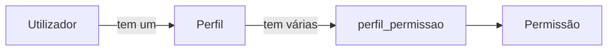

# 2. Perfis e permissões (RBAC)

[← Voltar ao README](../README.md)

## Como funciona

O acesso é controlado por **perfis** (*roles*). Cada utilizador tem um perfil, e cada perfil tem um conjunto de **permissões**. O código nunca pergunta "és administrador?"; pergunta "tens a permissão `socios.editar`?". Assim, mudar o que um perfil pode fazer é só ligar ou desligar uma permissão na base de dados, sem mexer no código.



## Permissões

| Grupo | Código | Descrição |
|---|---|---|
| Sócios | `socios.ver` | Ver lista e fichas de sócios |
| Sócios | `socios.editar` | Criar e editar sócios |
| Sócios | `socios.eliminar` | Eliminar sócios |
| Planos | `planos.gerir` | Criar, editar e remover planos |
| Mensalidades | `mensalidades.ver` | Ver as mensalidades de todos |
| Mensalidades | `mensalidades.registar` | Registar pagamentos |
| Mensalidades | `mensalidades.proprias` | Ver as próprias mensalidades (site) |
| Aulas | `aulas.ver` | Ver horário e inscritos |
| Aulas | `aulas.editar` | Criar e editar aulas |
| Aulas | `aulas.inscrever` | Inscrever-se em aulas (site) |
| Presenças | `presencas.marcar` | Marcar presenças |
| Acessos | `utilizadores.gerir` | Gerir utilizadores da equipa |
| Acessos | `perfis.gerir` | Gerir perfis e permissões |

## Matriz perfil × permissão

| Permissão | Administrador | Rececionista | Treinador | Sócio |
|---|:-:|:-:|:-:|:-:|
| `socios.ver` | ✅ | ✅ | | |
| `socios.editar` | ✅ | ✅ | | |
| `socios.eliminar` | ✅ | | | |
| `planos.gerir` | ✅ | | | |
| `mensalidades.ver` | ✅ | ✅ | | |
| `mensalidades.registar` | ✅ | ✅ | | |
| `mensalidades.proprias` | ✅ | | | ✅ |
| `aulas.ver` | ✅ | ✅ | ✅ ¹ | |
| `aulas.editar` | ✅ | ✅ | ✅ ¹ | |
| `aulas.inscrever` | ✅ | | | ✅ |
| `presencas.marcar` | ✅ | ✅ | ✅ ¹ | |
| `utilizadores.gerir` | ✅ | | | |
| `perfis.gerir` | ✅ | | | |
| **Total** | **13** | **7** | **3** | **2** |

¹ **Âmbito "só as suas":** o Treinador tem estas permissões apenas nas aulas em que é o treinador atribuído (`aulas.treinador_id` = utilizador da sessão).

O perfil **Administrador** tem sempre todas as permissões e não pode ser alterado, para ninguém ficar sem acesso à gestão.

## O que cada perfil vê no menu do back office

| Menu | Administrador | Rececionista | Treinador |
|---|:-:|:-:|:-:|
| Painel | ✅ | ✅ | ✅ |
| Sócios | ✅ | ✅ | |
| Planos | ✅ | | |
| Mensalidades | ✅ | ✅ | |
| Aulas | ✅ | ✅ | ✅ ("As minhas aulas") |
| Presenças | ✅ | ✅ | ✅ |
| Utilizadores | ✅ | | |
| Perfis e permissões | ✅ | | |

## Como vai ser aplicado no PHP (RBAC v1)

1. **Login:** o PHP procura o utilizador pelo email e confirma a palavra-passe com `password_verify()`.
2. **Sessão:** guarda em `$_SESSION` o id do utilizador, o perfil e a lista de códigos de permissão.
3. **Proteção de cada página:** no topo de cada página do back office, uma função verifica a permissão necessária. Sem permissão → resposta 403 ou redirecionamento.
4. **Menu:** só mostra as entradas para as quais o utilizador tem permissão.
5. **Âmbito do Treinador:** as consultas de aulas e presenças filtram por `treinador_id` quando o perfil é Treinador.

Exemplo de verificação (esboço):

```php
function pode(string $codigo): bool {
    return in_array($codigo, $_SESSION['permissoes'] ?? [], true);
}

function exigir(string $codigo): void {
    if (!pode($codigo)) {
        http_response_code(403);
        exit('Não tens permissão para aceder a esta página.');
    }
}

// no topo de socios.php
exigir('socios.ver');
```

> Este é um esboço da abordagem; a implementação faz parte da entrega do RBAC v1.
