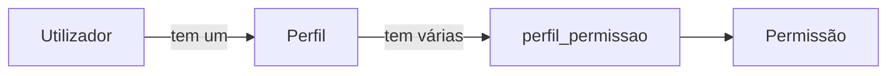

# 2. Perfis e permissões (RBAC)

[← Voltar ao README](../README.md)

## Como funciona

O acesso é controlado por **perfis** (*roles*). Cada utilizador tem um perfil, e cada perfil tem um conjunto de **permissões**. O código nunca pergunta "és gestor?"; pergunta "tens a permissão `socios.editar`?". Assim, mudar o que um perfil pode fazer é só ligar ou desligar uma permissão na base de dados, sem mexer no código.



## Perfis

| Perfil | Quem é | Onde entra |
|---|---|---|
| **Gestor** | Dono ou gestor do ginásio. Perfil bloqueado: as permissões não se alteram. | Back office |
| **Rececionista** | Atende os sócios e regista pagamentos. | Back office |
| **Treinador** | Dá as aulas; só mexe nas suas. | Back office |
| **Sócio** | Cliente do ginásio. | Área do sócio (site) |
| **Visitante** | Quem ainda não fez login. | Site público |

## Permissões: cada ação é uma permissão

Em vez de permissões largas como "gerir sócios", cada ação tem a sua: **ver**, **criar**, **editar** e **arquivar** (nada se apaga, para manter o histórico).

| Grupo | Código | Descrição |
|---|---|---|
| Site | `publico.ver` | Ver o site público (planos, horário, treinadores) |
| Site | `conta.criar` | Criar conta de sócio (registo) |
| Área do sócio | `mensalidades.proprias` | Ver as suas mensalidades |
| Área do sócio | `mensalidades.pagar` | Pagar as suas mensalidades (MB Way ou cartão) |
| Área do sócio | `aulas.inscrever` | Inscrever-se em aulas |
| Sócios | `socios.ver` | Ver sócios |
| Sócios | `socios.criar` | Criar sócios |
| Sócios | `socios.editar` | Editar sócios |
| Sócios | `socios.arquivar` | Arquivar sócios (o histórico fica guardado) |
| Planos | `planos.ver` | Ver planos |
| Planos | `planos.criar` | Criar planos |
| Planos | `planos.editar` | Editar planos e preços |
| Planos | `planos.arquivar` | Arquivar planos |
| Mensalidades | `mensalidades.ver` | Ver as mensalidades de todos |
| Mensalidades | `mensalidades.criar` | Criar mensalidades |
| Mensalidades | `mensalidades.registar` | Registar pagamentos (receção, MB Way ou cartão) |
| Aulas | `aulas.ver` | Ver aulas e inscritos |
| Aulas | `aulas.criar` | Criar aulas |
| Aulas | `aulas.editar` | Editar aulas |
| Aulas | `aulas.arquivar` | Arquivar aulas |
| Presenças | `presencas.marcar` | Marcar presenças |
| Dashboard | `dashboard.ver` | Ver o dashboard (indicadores e melhores sócios) |
| Equipa | `utilizadores.ver` | Ver a equipa |
| Equipa | `utilizadores.criar` | Criar utilizadores da equipa |
| Equipa | `utilizadores.editar` | Mudar o perfil de um utilizador |
| Equipa | `utilizadores.desativar` | Desativar e reativar utilizadores |
| Acessos | `perfis.ver` | Ver perfis e permissões |
| Acessos | `perfis.editar` | Alterar as permissões dos perfis |

## Matriz perfil × permissão

| Permissão | Gestor | Rececionista | Treinador | Sócio | Visitante |
|---|:-:|:-:|:-:|:-:|:-:|
| `publico.ver` | ✅ | ✅ | ✅ | ✅ | ✅ |
| `conta.criar` |  |  |  |  | ✅ |
| `mensalidades.proprias` |  |  |  | ✅ |  |
| `mensalidades.pagar` |  |  |  | ✅ |  |
| `aulas.inscrever` |  |  |  | ✅ |  |
| `socios.ver` | ✅ | ✅ |  |  |  |
| `socios.criar` | ✅ | ✅ |  |  |  |
| `socios.editar` | ✅ | ✅ |  |  |  |
| `socios.arquivar` | ✅ |  |  |  |  |
| `planos.ver` | ✅ | ✅ |  |  |  |
| `planos.criar` | ✅ |  |  |  |  |
| `planos.editar` | ✅ |  |  |  |  |
| `planos.arquivar` | ✅ |  |  |  |  |
| `mensalidades.ver` | ✅ | ✅ |  |  |  |
| `mensalidades.criar` | ✅ | ✅ |  |  |  |
| `mensalidades.registar` | ✅ | ✅ |  |  |  |
| `aulas.ver` | ✅ | ✅ | ✅ ¹ |  |  |
| `aulas.criar` | ✅ | ✅ |  |  |  |
| `aulas.editar` | ✅ | ✅ | ✅ ¹ |  |  |
| `aulas.arquivar` | ✅ |  |  |  |  |
| `presencas.marcar` | ✅ | ✅ | ✅ ¹ |  |  |
| `dashboard.ver` | ✅ |  |  |  |  |
| `utilizadores.ver` | ✅ |  |  |  |  |
| `utilizadores.criar` | ✅ |  |  |  |  |
| `utilizadores.editar` | ✅ |  |  |  |  |
| `utilizadores.desativar` | ✅ |  |  |  |  |
| `perfis.ver` | ✅ |  |  |  |  |
| `perfis.editar` | ✅ |  |  |  |  |
| **Total** | **24** | **12** | **4** | **4** | **2** |

¹ **Âmbito "só as suas":** o Treinador tem estas permissões apenas nas aulas em que é o treinador atribuído (`aulas.treinador_id` = utilizador da sessão). O filtro está na consulta SQL.

## O que cada perfil vê no menu do back office

| Menu | Gestor | Rececionista | Treinador |
|---|:-:|:-:|:-:|
| Painel | ✅ | ✅ | ✅ |
| Dashboard | ✅ | | |
| Sócios | ✅ | ✅ | |
| Planos | ✅ | ✅ | |
| Mensalidades | ✅ | ✅ | |
| Aulas | ✅ | ✅ | ✅ ("As minhas aulas") |
| Presenças | ✅ | ✅ | ✅ |
| Equipa | ✅ | | |
| Perfis e permissões | ✅ | | |

## Como está aplicado no PHP

Ficheiro `app/inc/bootstrap.php`:

1. **Login:** procura o utilizador pelo email e confirma a password com `password_verify()`; guarda só o id na sessão (`session_regenerate_id()` evita roubo de sessão).
2. **Permissões lidas da base de dados em cada pedido:** `utilizador()` junta o perfil e as permissões (`perfil_permissao`). Quem não tem sessão recebe as permissões do perfil **Visitante**. Mudar a matriz aplica-se logo.
3. **Cada página começa com `exigir('codigo')`:** se o Visitante tiver a permissão, a página abre sem login; se não houver sessão, vai para o login; se o perfil não tiver a permissão, responde **403**.
4. **Cada ação volta a verificar:** por exemplo, arquivar um sócio faz `exigir('socios.arquivar')` antes de gravar, mesmo que alguém envie o formulário à mão.
5. **Menu:** só mostra as entradas para as quais o perfil tem permissão (`pode()`).
6. **Âmbito:** `ambito('aulas.ver')` devolve `todas` ou `proprias`; com `proprias` a consulta SQL filtra por `treinador_id`.

```php
// no topo de backoffice/socios.php
exigir('socios.ver');

// ao arquivar
if ($_SERVER['REQUEST_METHOD'] === 'POST') {
    csrf_validar();
    exigir('socios.arquivar');   // sem a permissão → 403
    // ...
}
```
