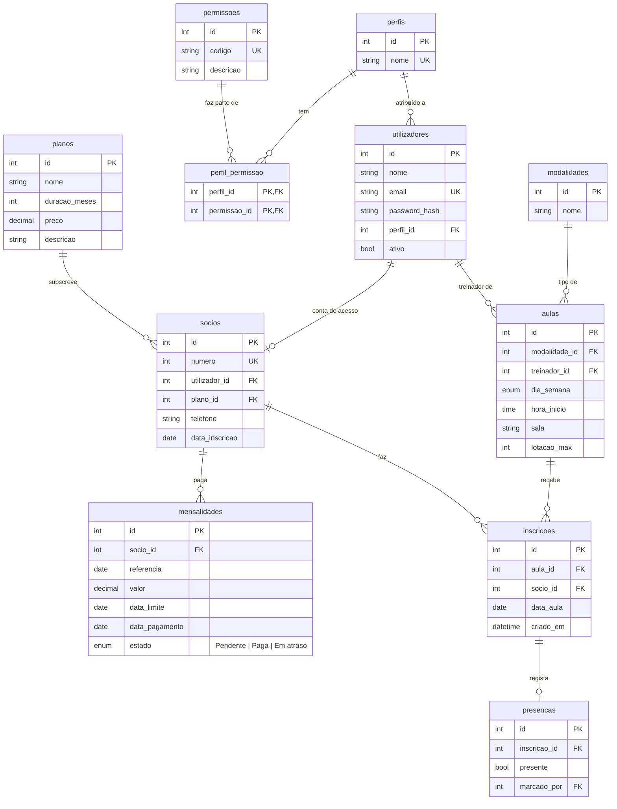

# 3. Modelo de dados e regras de negócio

[← Voltar ao README](../README.md)

## Tabelas

O modelo tem 11 tabelas, em três grupos:

| Grupo | Tabelas |
|---|---|
| Acessos (RBAC) | `utilizadores`, `perfis`, `permissoes`, `perfil_permissao` |
| Sócios e pagamentos | `socios`, `planos`, `mensalidades` |
| Aulas | `modalidades`, `aulas`, `inscricoes`, `presencas` |

## Diagrama entidade-relação (proposta)

> Os nomes das colunas são uma proposta e podem mudar na implementação.

## Regras de negócio

| # | Regra | Onde se aplica |
|---|---|---|
| R1 | Uma aula não aceita inscrições acima da **lotação máxima**. | Inscrição em aulas (site) |
| R2 | Um sócio com **mensalidade em atraso** não se pode inscrever em aulas. | Inscrição em aulas (site) |
| R3 | O sócio pode **cancelar** uma inscrição até [a definir] horas antes da aula. | Área do sócio |
| R4 | Uma mensalidade está *Pendente* até ao fim do prazo, *Paga* quando é registado o pagamento e *Em atraso* depois do prazo sem pagamento. | Mensalidades |
| R5 | O Treinador só vê e marca presenças nas aulas em que é o treinador atribuído. | Aulas e presenças |
| R6 | As palavras-passe nunca são guardadas em texto: usa-se `password_hash()`. | Registo e utilizadores |
| R7 | O perfil Administrador mantém sempre todas as permissões. | Perfis e permissões |
